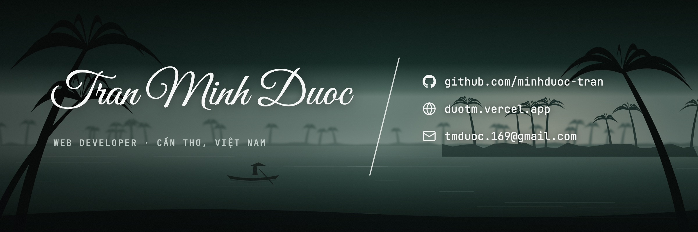

  
  
  
  

<h1 align="center">Hi there 👋, I'm Duoc</h1>

  A web developer from Cần Thơ, Việt Nam. I like building the data-heavy parts of an app: tables, filters, forms and dashboards that stay fast and clear with a lot of rows behind them. Most days I work in React, Next.js and TypeScript, and I'm at home on the backend too, with .NET, Spring Boot and FastAPI. In my free time I build open-source tools for other developers.

<h2 align="center">Tech Stack</h2>

  <picture>
    <source media="(prefers-color-scheme: dark)" srcset="https://skillicons.dev/icons?i=react,nextjs,ts,js,tailwind,redux,vue,angular,dotnet,cs,spring,java,fastapi,py,nodejs,postgres,mysql,mongodb,docker,git&perline=10&theme=dark" />
    
  </picture>

<h2 align="center">Projects</h2>

  <table>
    <thead>
      <tr>
        <th>Project</th>
        <th>What it is</th>
        <th>Built with</th>
        <th>Links</th>
      </tr>
    </thead>
    <tbody>
      <tr>
        <td><a href="https://github.com/minhduoc-tran/tablecn"><b>tablecn</b></a></td>
        <td>Data table blocks for shadcn/ui, with filter, search, sort and page all in the URL</td>
        <td>React · TanStack Table · shadcn/ui</td>
        <td nowrap><a href="https://table-cn.vercel.app">Demo</a>&nbsp;·&nbsp;<a href="https://table-cn.vercel.app/docs">Docs</a>&nbsp;·&nbsp;<a href="https://www.npmjs.com/search?q=%40querycn">npm</a></td>
      </tr>
      <tr>
        <td><a href="https://github.com/minhduoc-tran/filtercn"><b>filtercn</b></a></td>
        <td>A conditional filter component that turns complex queries into URL state or API parameters</td>
        <td>React · shadcn/ui</td>
        <td><a href="https://filtercn.vercel.app">Demo</a></td>
      </tr>
    </tbody>
  </table>

<h2 align="center">Statistics</h2>

  <picture>
    <source media="(prefers-color-scheme: dark)" srcset="https://github-readme-stats.vercel.app/api?username=minhduoc-tran&disable_animations=true&show_icons=true&hide_border=true&bg_color=00000000&title_color=4ade80&text_color=c9d1d9&icon_color=4ade80&ring_color=4ade80" />
    
  </picture>
  <picture>
    <source media="(prefers-color-scheme: dark)" srcset="https://github-readme-stats.vercel.app/api/top-langs/?username=minhduoc-tran&disable_animations=true&layout=compact&langs_count=6&hide_border=true&bg_color=00000000&title_color=4ade80&text_color=c9d1d9" />
    
  </picture>

<b>Made with ❤️ in Cần Thơ</b>

