<picture>
  <source media="(prefers-color-scheme: dark)" srcset="./assets/header-dark.svg" />
  
</picture>

## Hi, I'm Duoc

I'm a web developer from Cần Thơ, Việt Nam. I like building the data-heavy parts of an app: tables, filters, forms and dashboards that stay fast and clear with a lot of rows behind them.

Most days I work in React, Next.js and TypeScript, and I'm at home on the backend too, with .NET, Spring Boot and FastAPI. In my free time I build open-source tools for other developers.

&nbsp;&nbsp;

## Tech stack

**Frontend**

<picture>
  <source media="(prefers-color-scheme: dark)" srcset="https://skillicons.dev/icons?i=react,nextjs,ts,js,tailwind,redux,vue,angular&theme=dark" />
  
</picture>

**Backend**

<picture>
  <source media="(prefers-color-scheme: dark)" srcset="https://skillicons.dev/icons?i=dotnet,cs,spring,java,fastapi,py,nodejs&theme=dark" />
  
</picture>

**Data and tools**

<picture>
  <source media="(prefers-color-scheme: dark)" srcset="https://skillicons.dev/icons?i=postgres,mysql,mongodb,docker,git,vercel&theme=dark" />
  
</picture>

Also TanStack (Table, Query) and SQL Server.

## Projects

**[tablecn](https://github.com/minhduoc-tran/tablecn)**: data table blocks for shadcn/ui, with filter, search, sort and page all in the URL. Published to npm as [`@querycn`](https://www.npmjs.com/search?q=%40querycn) and listed in the shadcn registry directory.
[Demo](https://table-cn.vercel.app) · [Docs](https://table-cn.vercel.app/docs)

**[filtercn](https://github.com/minhduoc-tran/filtercn)**: a conditional filter component for data tables. Users build complex queries, and it turns them into URL state or API parameters.
[Demo](https://filtercn.vercel.app)
